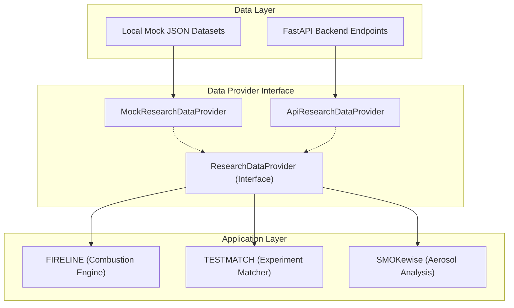

# FIRELINE — Canonical Data Contract & Architecture

## 1. Architectural Overview

**FIRELINE** is a unified AI-powered Spacecraft Fire-Safety Intelligence Engine integrating three analytical research modules:

1. **FIRELINE**: Combustion & fire-safety evidence intelligence (flammability, flame spread, ignition limits, heat release rate, and gaseous emissions).
2. **TESTMATCH**: Cross-experiment comparison, similarity analysis, environmental condition matching, and limitation identification.
3. **SMOKewise**: Smoke aerosol morphology, particle sizing distribution, soot volume fractions, smoke aging, and detector chamber response.

All three modules share a single canonical scientific data model and database schema, supporting both frontend mock exploration and future live NASA PSI / NTRS ingestion via FastAPI.

---

## 2. Canonical Entities

### A. Investigation (`shared/schemas/investigation.schema.json`)
Represents an authoritative NASA Physical Sciences Informatics (PSI) investigation.
- `id`: Pattern `^INV-[A-Z0-9-]+$` (e.g., `INV-BASS-II`, `INV-SAFFIRE-I`)
- `name`: Full title of the NASA investigation
- `short_name`: Recognizable mission/project abbreviation
- `psi_id`: NASA PSI identifier (`PSI-25`, `PSI-98`, `PSI-99`, `PSI-100`, `PSI-69`, `PSI-101`, `PSI-102`, `PSI-107`)
- `doi`: Digital Object Identifier or null
- `description`: Formal summary of scientific scope and experimental approach
- `research_objectives`: Array of key scientific targets
- `research_categories`: Categorization tags (e.g. `Solid Fuel Flammability`, `Droplet Combustion`)
- `module_tags`: Subset of `["FIRELINE", "TESTMATCH", "SMOKEWISE"]`
- `fire_safety_pillar`: `prevention` | `detection` | `suppression` | `supporting`
- `gravity_regimes`: Array of gravity environments (`microgravity`, `lunar_partial`, etc.)
- `fuel_types`: Materials burned or smoldered (e.g. `PMMA`, `Nomex`, `Teflon wire`)
- `source_ids`: References to `Source` records
- `official_url`: Verified NASA PSI repository URL
- `data_availability`: `public_metadata_only` | `partial_open_data` | `full_psi_dataset` | `synthetic_preview`
- `is_mock_metadata`: Boolean flag indicating synthetic status

### B. TestRun (`shared/schemas/test_run.schema.json`)
Represents a single burn point or experimental configuration.
- `id`: Pattern `^TR-[A-Z0-9-]+$`
- `investigation_id`: Parent investigation reference
- `test_label`: Descriptive label of the burn point
- `test_sequence`: Sequence index or null
- `gravity_regime`: Gravity environment
- `fuel_name`: Specific fuel formulation
- `fuel_family`: Chemical family (e.g. `Acrylic Thermoplastic`, `Fluoropolymer Insulation`)
- `geometry`: `flat_sheet` | `thin_fabric` | `cylindrical_rod` | `spherical_droplet` | `wire_insulation` | `heated_lamp_filament` | `structured_array`
- `sample_dimensions`: Length, width, thickness, diameter with raw values and normalized meters (`normalized_m`)
- `experimental_conditions`: Summary object with oxygen % vol, pressure kPa, airflow cm/s, ambient temp K, flow direction, ignition method
- `outcome_categories`: Array of observed behavior tags
- `measurement_ids`: References to tidy `Measurement` records
- `source_ids`: References to source documents
- `data_status`: `synthetic_demo` for mock records
- `is_mock`: Boolean flag (`true`)

### C. Measurement (`shared/schemas/measurement.schema.json`)
**Long/tidy data format**: One record represents one parameter measured or reported under one experimental condition.
- `id`: Pattern `^MEAS-[A-Z0-9-]+$`
- `test_run_id`: Parent test run reference
- `investigation_id`: Parent investigation reference
- `parameter_code`: Canonical code from parameter dictionary
- `parameter_label`: Human-readable label
- `parameter_category`: Parameter grouping (e.g. `atmospheric_condition`, `flame_dynamics`, `smoke_aerosol`)
- `measurement_role`: `condition` | `outcome`
- `raw_value`: Original reported numerical value (or null)
- `raw_unit`: Original unit string
- `normalized_value`: Deterministically converted canonical SI value (or null if ambiguous/unreported)
- `normalized_unit`: Canonical SI unit (e.g. `mol/mol`, `m/s`, `Pa`, `K`, `m`, `1/m³`, `kg/m³`, `W`, `s`, `V`)
- `display_unit`: Recommended UI display unit (e.g. `% vol`, `cm/s`, `kPa`, `mm/s`, `nm`)
- `minimum_value` / `maximum_value`: Range boundaries or null
- `time_s`: Elapsed time timestamp (seconds) or null
- `sensor`: Sensor instrument name or null
- `measurement_method`: Method/technique description or null
- `uncertainty`: Measurement variance or synthetic disclaimer string
- `data_status`: `synthetic_demo`
- `source_id`: Source record reference
- `is_mock`: Boolean flag (`true`)

### D. Finding (`shared/schemas/finding.schema.json`)
Scientific observations, calculations, or research implications.
- `id`: Pattern `^FND-[A-Z0-9-]+$`
- `investigation_id`: Parent investigation reference
- `related_test_run_ids`: Array of linked test run IDs
- `title`: Short title
- `finding_text`: Detailed finding description (explicitly includes synthetic demo disclaimer)
- `summary`: Concise summary
- `research_category`: Scientific domain tag
- `module_tags`: Modules where this finding applies
- `evidence_type`: `observed` | `calculated` | `interpretation` | `research_implication`
- `confidence_label`: `high` | `moderate` | `preliminary` | `illustrative_synthetic`
- `limitations`: Known limitations or synthetic placeholders
- `source_references`: Array of linked source IDs
- `data_status`: `synthetic_demo`
- `is_mock`: `true`

### E. Source (`shared/schemas/source.schema.json`)
Authoritative bibliographic records for NASA PSI portals, NTRS technical reports, and standards.
- `id`: Pattern `^SRC-[A-Z0-9-]+$`
- `source_type`: `psi_investigation` | `ntrs_report` | `scientific_publication` | `nasa_guide` | `historical_case`
- `title`: Formal publication/repository title
- `organization`: Publishing center (e.g., NASA GRC, NASA JSC, NASA PSI)
- `investigation_id`: Linked investigation or null
- `url`: Direct canonical URL
- `doi`: Official DOI or null (never fabricated)
- `verification_status`: `verified_public_url` | `metadata_verified` | `pending_ingestion` | `illustrative_reference`

### F. EvidenceChunk (`shared/schemas/evidence_chunk.schema.json`)
Structured text chunk for future Retrieval-Augmented Generation (RAG) vector indexing.
- `id`: Pattern `^CHK-[A-Z0-9-]+$`
- `source_id`: Source reference
- `investigation_id`: Linked investigation
- `text`: Chunk text
- `page_number`: Document page number or null
- `section_title`: Heading/section name
- `chunk_index`: Integer sequence
- `embedding_reference`: Vector ID or null
- `is_mock`: `true`

### G. Comparison (`shared/schemas/comparison.schema.json`)
TESTMATCH multi-run comparison contract.
- `id`: Pattern `^CMP-[A-Z0-9-]+$`
- `test_run_a_id` / `test_run_b_id`: Test run references
- `comparison_parameters`: Evaluated parameter codes
- `matching_parameters` / `differing_parameters` / `unavailable_parameters`: Categorized parameter lists
- `weighted_score`: Normalized similarity score (0.0 to 1.0)
- `data_coverage`: Fractional metric coverage (0.0 to 1.0)
- `methodology`: Explanation of matching algorithm
- `limitations`: Comparison constraints (e.g. geometric scale disparity)
- `parameter_deltas`: Array of detailed numerical deltas
- `is_mock`: `true`

### H. ResearchReport (`shared/schemas/research_report.schema.json`)
Integrated cross-module synthesis report.
- `id`: Pattern `^RPT-[A-Z0-9-]+$`
- `title`: Report title
- `research_question`: Scientific hypothesis or query
- `executive_summary`: Multi-paragraph synthesis
- `investigation_ids` / `finding_ids` / `comparison_ids` / `source_ids`: Linked entities
- `analytical_results`: Per-module findings, metrics, and fire safety implications
- `limitations`: Explicit synthetic demo disclaimers
- `generated_at`: ISO 8601 timestamp
- `is_mock`: `true`
