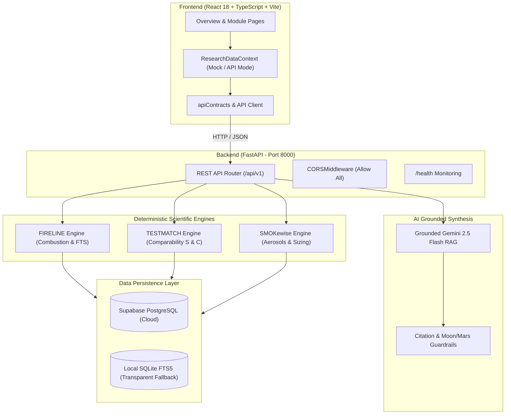
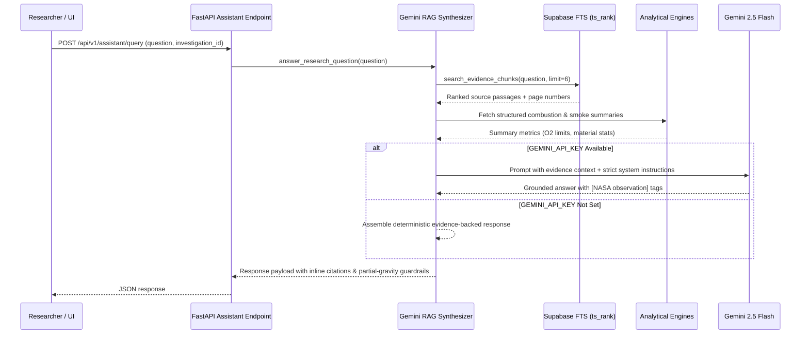

# FIRELINE Architecture & Engineering Specification

**Astro_Sapien • NASA Space Apps / HackAthlone 2026**

This document details the software architecture, data pipelines, analytical engines, and API contracts of the **FIRELINE Spacecraft Fire-Safety Intelligence Engine**.

---

## 1. System Overview



---

## 2. Directory Layout

The workspace is organized into discrete, modular subsystems:

```text
Astro_Sapien/
│
├── frontend/                      # React 18 SPA (Vite, Tailwind, Recharts, Lucide)
│   ├── src/                       # Components, Pages, State, and Providers
│   ├── public/                    # Static UI assets
│   ├── package.json               # Frontend dependencies & npm scripts
│   └── vite.config.ts             # Path aliases (@, @shared, @datasets)
│
├── backend/                       # Python FastAPI application
│   ├── app/
│   │   ├── ai/                    # Gemini 2.5 Flash RAG synthesizer & guardrails
│   │   ├── core/                  # Configuration & environment variables
│   │   ├── database/              # Schema definition, connection pooling & fallbacks
│   │   ├── engines/               # Three deterministic analytical engines
│   │   └── ingestion/             # Batch A & Batch B data parsers & document chunker
│   ├── data/
│   │   ├── raw/                   # Raw NASA spreadsheets, CSVs, and technical PDFs
│   │   ├── processed/             # normalized_test_runs.json
│   │   └── manifests/             # source_manifest.json
│   ├── tests/                     # Automated pytest suite (100% pass)
│   └── main.py                    # Application entry point
│
├── shared/                        # Shared schemas, contracts & SI parameter dictionaries
│   ├── schemas/                   # JSON Schemas (test_run, finding, report, etc.)
│   ├── types/                     # TypeScript types
│   └── api-contract.md            # API request/response specification
│
├── datasets/                      # Mock datasets and downloaded NASA sources
├── docs/                          # Architecture, Data Sources, and Standards
├── openapi.json                   # Exported OpenAPI 3.1 specification
└── README.md                      # Primary project overview
```

---

## 3. The Three Deterministic Scientific Engines

### 3.1 FIRELINE Combustion & Suppression Engine (`backend/app/engines/fireline_engine.py`)
- **Capabilities**:
  - Filters combustion data across `BASS-II`, `SAFFIRE`, and `FLEX` by material, geometry, flow regime, and initial $\text{O}_2\%$.
  - Executes full-text search across 662 document chunks using PostgreSQL `ts_rank` and `websearch_to_tsquery` (with BM25 translation on SQLite fallback).
  - Flags the **Partial-Gravity Limitation Notice** noting that NASA PSI datasets lack validated Lunar ($1/6g$) or Martian ($3/8g$) flammability data.

### 3.2 TESTMATCH Comparability Engine (`backend/app/engines/testmatch_engine.py`)
- **Deterministic Comparability Formula**:
  $$S = 100 \times \frac{\sum w_i m_i s_i}{\sum w_i m_i}$$
- **Data Coverage Metric**:
  $$C = 100 \times \frac{\sum w_i m_i}{\sum w_i}$$
- **Evaluated Parameters**:
  1. Gravity regime ($w=1.5$)
  2. Material ($w=2.0$)
  3. Geometry ($w=1.2$)
  4. Flow regime ($w=1.2$)
  5. Experimental scale ($w=1.5$)
  6. Initial oxygen concentration ($w=1.0$)
  7. Initial airflow velocity ($w=1.0$)
  8. Total chamber pressure ($w=0.8$)
  9. Characteristic sample dimension ($w=0.8$)
- **Enforced Scientific Warnings**:
  - **Scale Divergence**: Flags comparison between $1\text{--}2\text{ cm}$ MSG flow duct samples (`BASS-II`) and $0.4\text{ m} \times 0.94\text{ m}$ spacecraft composite panels (`SAFFIRE`).
  - **Cross-Domain Complementary**: Highlights non-interchangeable domains (solid flame spread vs. liquid droplet extinction vs. smoke aerosol pyrolysis).
  - **Sensor Quality Flags**: Automatically detects and reports `suspect` or `over_range` measurement values.

### 3.3 SMOKEWISE Smoke Aerosol & Detection Engine (`backend/app/engines/smokewise_engine.py`)
- **Capabilities**:
  - Aggregates microgravity smoke particle growth across 5 spacecraft materials: Kapton, Teflon, Silicone, Lampwick, and Pyrell.
  - Computes mass-mean diameter ($d_{mm}$) and geometric mean diameter ($d_g$) across aging periods ($11\text{--}1800\text{ s}$) and ventilation regimes.
  - Evaluates detector performance implications for ISS near-IR light scattering, Space Shuttle ionization chambers, and the MPASS two-moment prototype.
  - Keeps flaming soot point data (`SPICE`) segregated from pyrolysis aerosol data (`SAME-R`).

---

## 4. Grounded Gemini 2.5 Flash RAG

The RAG synthesizer (`backend/app/ai/gemini_rag.py`) operates under strict scientific constraints:



---

## 5. Automated Testing & Verification

The test suite (`backend/tests/test_backend.py`) verifies:
- Database connectivity and table counts on `/health`.
- Investigation retrieval across all 5 NASA missions.
- Multi-parameter filtering on test runs and measurement joins.
- Document and report provenance lookups.
- Full-text search ranking and snippet extraction.
- Deterministic comparability scoring and warning generation in TESTMATCH.
- Smoke aerosol aggregation across 5 materials and detector implications in SMOKewise.
- Mandatory claim tagging and Moon/Mars guardrails in Gemini RAG.
- Multi-pillar integrated report generation.
